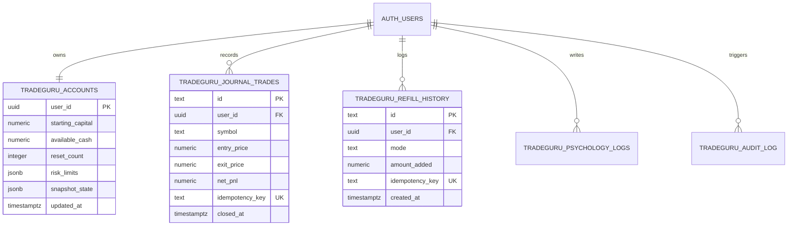

# TradeGuru AI — Database Architecture & Schema Design

## 1. Entity-Relationship Diagram

## 2. Immutability & Financial Integrity Guarantees
* **Migration `001_tradeguru_schema.sql`:** Establishes Row-Level Security (`auth.uid() = user_id`) and omits `DELETE` policies on `tradeguru_journal_trades`, `tradeguru_refill_history`, and `tradeguru_audit_log`.
* **Migration `002_enterprise_hardening.sql`:**
  1. Adds PostgreSQL `BEFORE UPDATE` trigger (`enforce_journal_financial_immutability`) on `tradeguru_journal_trades` that raises an exception if any financial column (`entry_price`, `exit_price`, `quantity`, `gross_pnl`, `charges`, `net_pnl`, `closed_at`, `symbol`, `side`) is modified—allowing ONLY `reflection` and `post_emotion` updates!
  2. Adds `idempotency_key` unique constraints to prevent duplicate trade/refill writes during network retries.
  3. Adds composite cursor-pagination indexes `(user_id, closed_at DESC, id DESC)` for O(log N) keyset pagination instead of slow `OFFSET` queries.
  4. Adds `CHECK` constraints enforcing positive quantities and valid price bounds.

## 3. Connection Pooling, Caching & Source of Truth
* **Connection Pooling:** Supabase PgBouncer (Transaction mode on port `6543`) handles serverless burst traffic from Vercel cleanly.
* **Redis Evaluation:** Redis is **NOT** required at current scale; in-memory route TTL caching (15s) + PgBouncer + browser `localStorage` satisfy latency targets without adding infrastructure cost or failure modes.
* **Java `PortfolioController` Reconciliation:** Supabase PostgreSQL is the authoritative source of truth for user accounts; the Java `PortfolioController` is scoped strictly as an optional standalone Spring Boot sandbox/demo service and must never hold conflicting production state.
