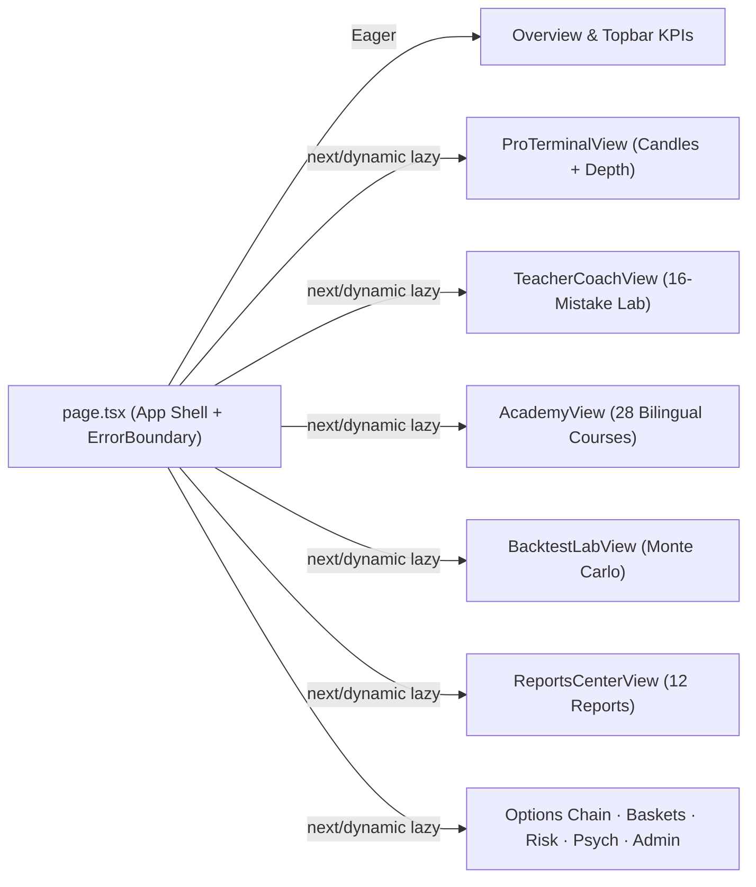

# TradeGuru AI — Frontend Architecture

## 1. Component & Code-Splitting Architecture

## 2. State Management Evaluation (Zustand, TanStack Query, IndexedDB)
* **Why Zero Extra State Libraries Today:** TradeGuru AI currently operates cleanly with React 19 state + pure domain reducers (`paper-engine.ts`), `localStorage` offline persistence, and `next/dynamic` code splitting—keeping `package.json` lean (4 runtime dependencies).
* **When to Introduce:**
  * **Zustand:** Introduce if market-tick subscriptions expand to >50 concurrent WebSocket symbols so non-terminal views never subscribe to tick atoms.
  * **TanStack Query:** Introduce once server-side cursor-paginated trade histories (>1,000 trades/user) move out of the initial snapshot into dedicated API endpoints.
  * **IndexedDB:** Introduce when storing multi-year 1-minute OHLCV historical datasets (>5 MB per symbol, exceeding `localStorage` limits).

## 3. Resilience & UX Standards
* **Error Boundaries:** Dedicated `<WorkspaceErrorBoundary>` wraps active views so a runtime error in a third-party widget or chart offers a 1-click Recovery button without crashing the workspace.
* **Skeleton Loading:** `next/dynamic` lazy views display a clean skeleton panel during chunk load.
* **Accessibility & Shortcuts:** Keyboard navigation (`B` Buy, `S` Sell, `F` Fullscreen, `Esc` Close), `aria-current`, `role="dialog"`, and mobile-responsive grids.
