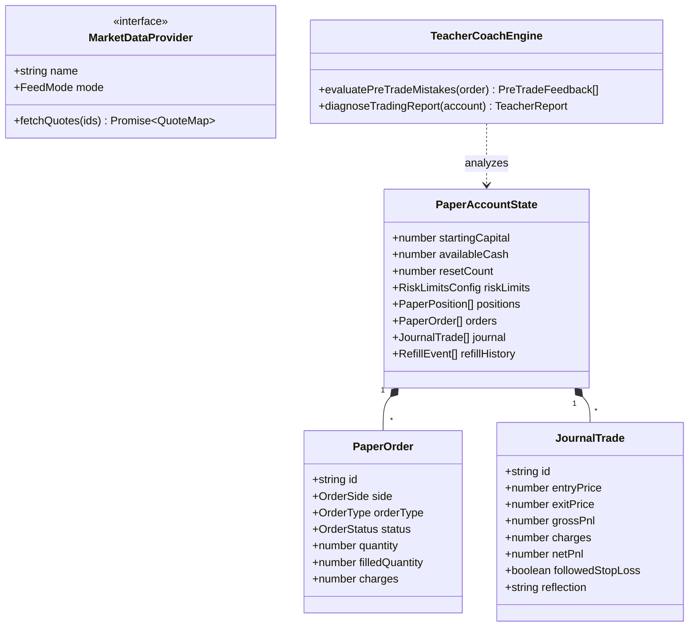
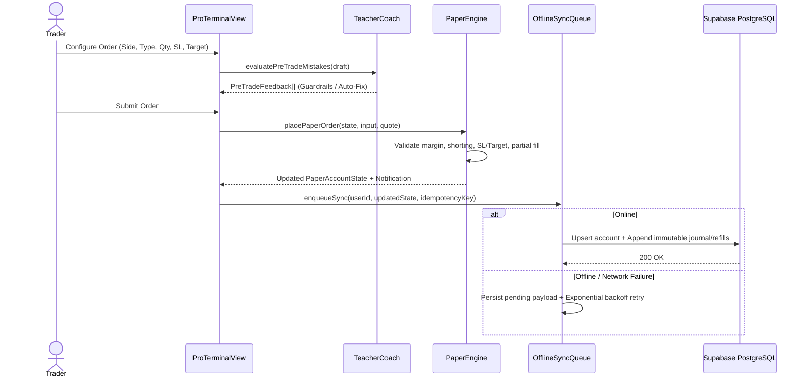

# TradeGuru AI — Low-Level Design (LLD)

## 1. Domain Class Diagram

## 2. Order Placement & Cloud Sync Sequence Diagram

## 3. Design Patterns & SOLID Principles
* **Strategy Pattern:** `MarketDataProvider` (`SimulatedRegimeProvider`, `YahooDelayedProvider`, future broker WebSockets) and `BacktestRuleType` (`EMA_CROSS`, `RSI_MEAN_REVERSION`, `BOLLINGER_BREAKOUT`, `MACD_MOMENTUM`).
* **Pure Reducer Functions:** `placePaperOrder`, `closePaperPosition`, `performSafeAccountRefill`, and `processMarketTickOnAccount` are pure state transitions—deterministic, unit-testable, and free of side effects.
* **Circuit Breaker & Token Bucket:** Applied in `/api/market/quotes` to protect upstream Yahoo Finance calls and prevent abuse.
* **Dependency Inversion:** UI components depend on typed domain contracts (`LiveQuote`, `PaperAccountState`, `TeacherReport`) rather than storage or transport details.
