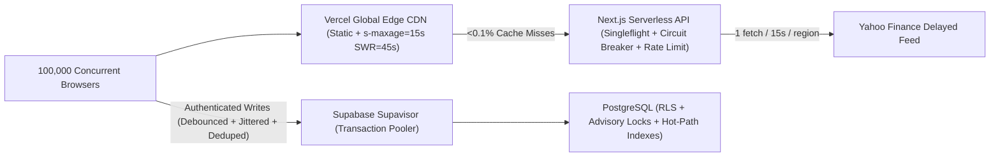

# TradeGuru AI — High-Concurrency System Design (HLD & LLD)

## 1. High-Level Design (HLD) for 100,000 Concurrent Visitors

## 2. Low-Level Design (LLD) Protections Implemented in Code

| Bottleneck at 100k Users | LLD Mechanism Applied | Source File |
| :--- | :--- | :--- |
| **Market Quote Thundering Herd** | `Cache-Control: public, s-maxage=15, stale-while-revalidate=45` + `CDN-Cache-Control` + in-flight singleflight coalescing + 60s circuit breaker | `nextrade-web/src/app/api/market/quotes/route.ts` |
| **Synchronized Client Polling** | Removed `cache: "no-store"`, added Page Visibility API pause (idle tabs stop polling), and randomized 25s–35s polling jitter | `nextrade-web/src/app/page.tsx` |
| **Database Write Storms** | Jittered 2.2s–3.4s debounce + serialized payload-fingerprint deduplication (skips Supabase `upsert` when state is unchanged) | `nextrade-web/src/app/page.tsx` |
| **Double-Spend / Race Conditions** | Per-account transactional advisory lock (`pg_advisory_xact_lock`), negative-balance guard, and optimistic version checks | `supabase/migrations/016_security_audit_fixes.sql` |
| **Privilege Escalation / Function Abuse** | `REVOKE ALL FROM PUBLIC, anon`, `auth.uid()` ownership enforcement, complete RLS across all 39 multi-tenant tables | `supabase/migrations/016_security_audit_fixes.sql` |
| **API Abuse & DoS** | Per-IP rate limiting + `aal2` MFA on `/api/admin/audit`, `x-health-token` gating on `/api/health`, 60 req/min + 16 KB body cap on `/api/trading/validate` | `nextrade-web/src/app/api/*/route.ts` |

## 3. Honest Infrastructure Scaling Tiers (Code vs. Hosting Plan)

Good software architecture eliminates self-DDoS, but real-world concurrency also depends on your hosting tier:

| Concurrent Users | Expected Behavior | Required Hosting Tier |
| :--- | :--- | :--- |
| **Up to ~1,000–2,000** (mostly guest / Edge-cached reads) | Runs smoothly with Edge CDN absorbing 99%+ of quote traffic | **Vercel Hobby + Supabase Free** (current setup) |
| **5,000 – 25,000** (mixed guest + authenticated traders) | Needs higher DB connection pool & commercial bandwidth | **Vercel Pro + Supabase Pro (Supavisor Transaction Mode) + Upstash Redis rate limiting** |
| **100,000+ simultaneous authenticated writers** | Requires multi-region DB scaling & distributed rate limiting | **Vercel Enterprise + Supabase Team/Enterprise (Large/XL Compute + Read Replicas + Dedicated PgBouncer) + Redis/Queue write-behind** |
