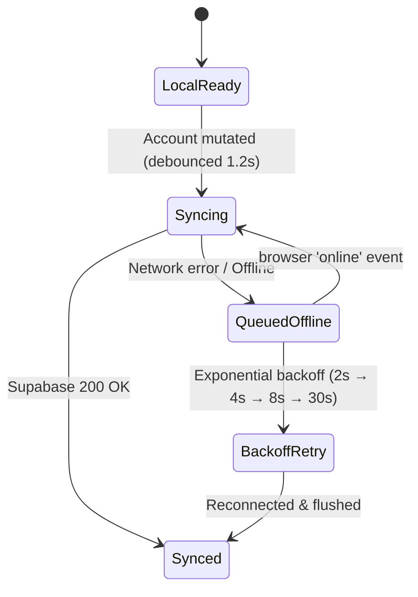

# TradeGuru AI — Scalability, Reliability & Real-Time Sync Architecture

## 1. Real-Time & Offline Cloud Synchronization Flow

## 2. Market Data Provider Abstraction
TradeGuru AI isolates market data transport behind `MarketDataProvider` (`src/lib/market-provider.ts`):
1. **`YahooDelayedProvider`**: Calls `/api/market/quotes` (15s TTL cache, rate-limited, circuit-breaker protected). Always labeled `DELAYED`.
2. **`SimulatedRegimeProvider`**: Deterministic + Gaussian regime tick engine (`BULL`, `SIDEWAYS`, `CORRECTION`, `VOLATILITY_SPIKE`). Always labeled `SIMULATED`.
3. **`BrokerWebSocketProvider` (Adapter Interface)**: Ready interface with automatic reconnection, exponential backoff, heartbeat monitoring, and subscription cleanup so authorized Indian broker feeds (Flattrade Pi/Noren, Upstox, Dhan, Kite) can plug in without modifying UI components.

## 3. Scaling Stages
* **0 – 10,000 Users (Current):** Vercel Serverless + Supabase Free/Pro (PgBouncer) + Client-side execution engine. Zero fixed server cost.
* **10,000 – 100,000 Users:** Add dedicated background worker (Render/Fly.io) for scheduled weekly PDF digest emails, global discipline leaderboards, and authorized broker WebSocket fan-out via Redis Pub/Sub.
