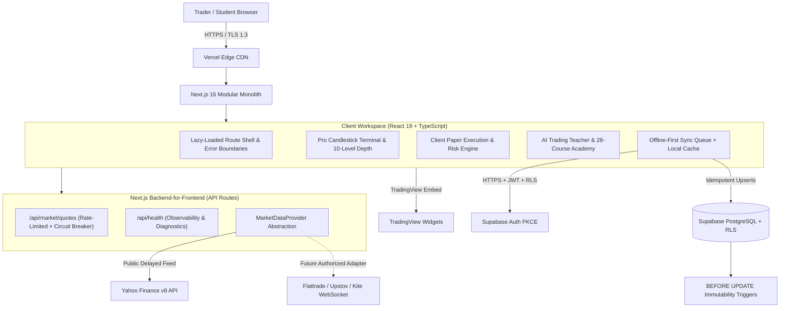

# TradeGuru AI — High-Level System Architecture (HLD)

## 1. Architectural Style
TradeGuru AI follows a **Modular Monolith** architecture on Next.js 16 (App Router + Server Route Handlers) backed by **Supabase (Auth + PostgreSQL with Row-Level Security)**, with an optional **Java Spring Boot Matching Engine (`nextrade-api`)** for institutional order-book experimentation. Microservices are intentionally avoided until sustained concurrency (>10,000 concurrent live sessions) justifies distributed network overhead.

## 2. System Context & Component Boundaries

## 3. Core Subsystems & Responsibilities
1. **Authentication & Authorization:** Supabase Auth (PKCE flow, email verification, password recovery). Every PostgreSQL query is enforced by Row-Level Security (`auth.uid() = user_id`). No service-role keys exist in frontend bundles.
2. **Market Data Ingestion & Distribution:** Accessed through a `MarketDataProvider` interface (`YahooDelayedProvider`, `SimulatedRegimeProvider`, and pluggable `BrokerWebSocketProvider`). All UI surfaces explicitly distinguish `DELAYED` public reference quotes from `SIMULATED` execution fills.
3. **Trading Simulation Engine:** Deterministic client-side execution supporting Market, Limit, Auto-Limit, SL, SL-M, Bracket, and Cover orders, partial fills, realistic Indian charges (STT/CTT, GST, SEBI fees, stamp duty), and margin blocking.
4. **Virtual Account & Safe Refill Engine:** Default ₹10,00,000 capital with automatic/manual refills that safely resolve open positions/orders while permanently preserving historical trades, reports, AI Teacher feedback, and refill audit records.
5. **AI Trading Teacher & 28-Course Bilingual Academy:** Rule-based 16-mistake detector with 8-point educational breakdowns, Good Process Loss recognition, live pre-trade guardrails, and English/Hindi curriculum.
6. **Backtesting & Analytics:** Zero-look-ahead bar-by-bar simulator with transaction costs, slippage, Walk-Forward train/test validation, and 200-run Monte Carlo bootstrap.
7. **Cloud Sync & Offline Resilience:** Offline-first `localStorage` + pending sync queue with exponential backoff and idempotency keys synchronizing to Supabase PostgreSQL.
8. **Observability & Health:** Structured latency/error telemetry, `/api/health` diagnostics, and immutable audit logs.
